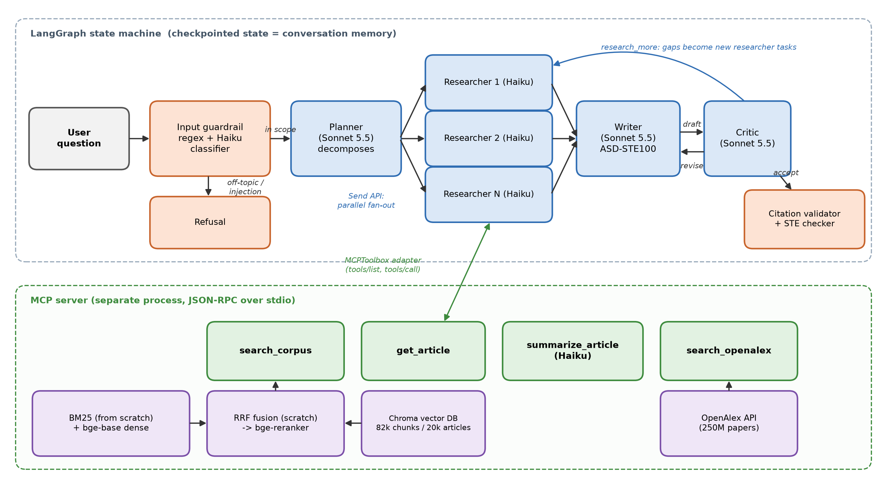

# CleanTech Research Crew: project brief

A plain-language guide to what this project is, how it works, and what the evaluation numbers mean.
Use it to prepare for questions about the project (class, interviews, resume).

---

## 1. The one-paragraph pitch

I built a question-answering system over 20,000 clean-energy news articles. Instead of one chatbot
that searches once and answers, it is a **team of AI agents**: a *planner* breaks the question into parts,
several *researchers* search the articles in parallel, a *writer* combines what they found into one cited
answer, and a *critic* checks every claim and number against the sources and sends the work back if
something is wrong. All the tools the agents use (search, read an article, summarize, search scientific
papers) live behind a **Model Context Protocol (MCP) server**, the open standard that Claude, ChatGPT and
IDEs now use to plug in tools. I evaluated it on 50 hard multi-article questions against a simpler
single-agent baseline, with a separate AI model (GPT-5.5) acting as the grader.

**Resume lines** (all numbers are real and defensible; pick one or two):

- *Built a multi-agent RAG system (LangGraph, Claude, Model Context Protocol) over 20k cleantech news articles:
  from-scratch BM25 + dense hybrid retrieval with reranking, parallel planner/researcher/writer/critic agents,
  guardrails and conversation memory.*
- *Designed a rigorous evaluation (cross-family LLM-as-judge with test-retest kappa 0.82, bootstrap CIs, ablations):
  retrieval raised answer fact recall from 47% to 67%; multi-agent decomposition found 17% more source articles,
  and ablations showed a single ReAct agent matched the crew's answer quality at 1/8 of the cost.*
- *Implemented BM25 from scratch that outperformed a transformer embedding model on entity-heavy news
  (MRR 0.64 vs 0.54) at 4 ms/query over 82k chunks.*

The honest "more agents did not win" result is a strength in interviews: it shows you measure instead of
assuming, and you know why it happened (section 5).

---

## 2. How it works, step by step

Follow one question through the system: *"Compare the Kosice geothermal project in Slovakia with Diverso
Energy's approach in North America."*

1. **Input guardrail.** A quick pattern check catches attempts like "ignore your instructions". Then a
   small, cheap model (Claude Haiku) labels the message: in scope, off-topic, harmful, or injection. Only
   in-scope questions continue. *Why:* safety, and not wasting money on off-topic questions.

2. **Planner (Claude Sonnet).** Rewrites the question so it stands alone (this is where memory matters: a
   follow-up like "how much did *that* project cost?" becomes "how much did the Kosice project cost?").
   Then it splits the question into sub-questions, one per entity: one about Kosice, one about Diverso.
   Each gets 2 or 3 keyword search queries. *Why:* one search can't find two different articles well;
   two focused searches can.

3. **Researchers (Claude Haiku, one per sub-question, in parallel).** Each is a small agent that loops:
   search, read results, maybe open or summarize a full article, search again, then write notes with
   article ids. *Why parallel:* faster, and each researcher's context stays focused on one topic.

4. **Writer (Claude Sonnet).** Gets all notes and source passages and writes one synthesized answer,
   citing an article id after every fact, in **ASD-STE100** style (short sentences, one idea each, active
   voice). *Why STE:* Andrej Karpathy's suggestion from the course reading. People now mostly *review*
   AI output, so it should be easy to check, not padded.

5. **Critic (Claude Sonnet).** Compares every claim and number with the evidence. Three possible
   decisions: *accept*; *revise* (back to the writer with specific fixes); or *research_more* (its list of
   gaps becomes new researcher tasks; this is the agents-talking-to-agents part).

6. **Output guardrail.** Code (not AI) checks that every cited article id was actually retrieved, and
   deletes any citation that wasn't. That catches "hallucinated sources". A second piece of code scores how
   well the answer follows the STE rules.

### The search engine underneath (the `search_corpus` tool)

- **Chunking:** each article is cut into ~250-word pieces, each tagged with the article title.
- **BM25 (written from scratch):** classic keyword search. Great at exact names like "Kosice" or "CMBlu".
- **Dense search:** each chunk is turned into a 768-number vector (bge-base model) stored in a
  **Chroma** vector database; finds chunks with similar *meaning* even with different words.
- **Reciprocal Rank Fusion (from scratch):** merges the two ranked lists using only the positions.
- **Reranker:** a cross-encoder model reads the question and each of the top 30 chunks *together* and
  re-scores them. Slower but much more precise.

### Why each design choice is "modern practice"

| Choice | What it replaces | Why it is better |
|---|---|---|
| LangGraph state machine | a single agent loop | explicit, testable control flow; parallel branches; checkpointed memory |
| MCP server for tools | tools hard-coded inside the agent | any MCP client can reuse the tools; process isolation |
| Hybrid search + reranking | embeddings only | names and numbers matter in news; reranking adds precision |
| Structured outputs (Pydantic) | parsing free text | agents return validated JSON decisions |
| Cheap model for volume, strong model for judgment | one model everywhere | Haiku costs ~5% of Sonnet per token |
| Judge from another company (GPT-5.5) | the system grading itself | avoids "self-preference" bias |
| Cached runs | re-calling APIs on every run | reproducible numbers, no repeated cost |

---

## 3. The Part 1 baseline (what we compare against)

A single ReAct agent (Claude Sonnet) with exactly two tools: `retrieve` (dense search in Chroma, top 5)
and `summarize` (Haiku). It decides on its own when to search and when to answer. This satisfies the
assignment's Part 1 and is the yardstick for the Part 2 system.

---

## 4. What the evaluation numbers mean

### 4.1 The test

50 hard questions written by the instructor. Each comes with a **desired answer** (written from 1-5 specific
articles) and the **ids of those articles**. So two things can be checked: did the system *find* the right
articles (retrieval), and does its *answer* match the desired one (response).

### 4.2 Retrieval numbers (did we find the right articles?)

Think of each system returning a ranked list of articles, like Google results.

| Metric | Plain meaning | Range | Our numbers |
|---|---|---|---|
| **Recall@k** (R@5, R@10) | Of the articles the question is based on, what share appear in the top k results? R@10 = 0.67 means two-thirds of the needed articles are on "page one". | 0-1, higher better | BM25 0.63, dense 0.54, hybrid + rerank **0.67**, crew v2 **0.70** |
| **MRR** (mean reciprocal rank) | How high is the *first* correct article? 1st place = 1.0, 2nd = 0.5, 3rd = 0.33. Averaged over questions. | 0-1 | BM25 **0.64** vs dense 0.54 |
| **nDCG@10** | Like recall, but finding a correct article at rank 1 counts more than at rank 9. | 0-1 | hybrid + rerank **0.58** best |
| **Evidence recall** | Of the needed articles, what share did the agent *read at all* during its research? | 0-1 | baseline 0.66, crew v2 **0.77** |
| **Citation recall** | ...and what share did it *cite* in its final answer? | 0-1 | baseline 0.65, crew v2 **0.71** |
| **Citation precision** | Of the articles it cited, what share were the "official" ones? Low does not mean wrong: other articles can support the same facts. | 0-1 | baseline **0.39**, crew v2 0.29 |

**Takeaway:** keyword search (BM25, which I wrote from scratch) beats the AI embedding model here, because the
questions are full of names like "Kosice" and "Diverso" that must match exactly. The crew *finds* the most.

### 4.3 Answer numbers (is the answer right?)

**Automatic overlap metrics** (cheap, but shallow):

| Metric | Plain meaning | Our numbers |
|---|---|---|
| **ROUGE-L** | How many words appear in the same order as in the desired answer. Rewards copying wording, not being right. | 0.14-0.18 for all systems. Low values are normal for free-form answers. |
| **BERTScore** (rescaled) | Word-by-word *meaning* match using a language model. 0 means unrelated text; around 0.1 here means "same topic, different phrasing". | 0.06 (no retrieval) to 0.11 (baseline) |
| **Semantic similarity** | Cosine similarity of whole-answer embeddings. Nearly everything on-topic scores 0.85+. | 0.85-0.86, too flat to separate systems |

These barely separate the systems, so the main metric is an **AI judge** (GPT-5.5, deliberately a different
company's model so it does not favour Claude):

| Metric | How it is computed | Our numbers |
|---|---|---|
| **Fact recall** (main metric) | The judge splits each desired answer into ~7.6 atomic facts ("Kosice gets EUR 56.1M from the Just Transformation Fund"). For each answer it marks every fact supported / partial / missing / contradicted. Fact recall = (supported + half of partial) / total. **0.67 = the answer contains about two-thirds of the expected facts.** | no retrieval 0.47 -> baseline **0.67**; crew v2 0.60; crew v2 plain prose **0.68** |
| **Correctness** (1-5) | Overall grade against the desired answer. 5 = fully right and complete, 3 = mostly right with gaps, 1 = wrong. | 3.06 -> **3.76** (baseline), 3.84 best |
| **Faithfulness** | Of the claims in the answer, what share do the cited articles actually support? Measures *hallucination*, independent of the desired answer. | **0.97** baseline, 0.93 crew: answers are well grounded |
| **Contradiction rate** | Share of desired facts the answer gets *wrong* (not just omits). | 1-4%, so errors are mostly omissions, not falsehoods |

### 4.4 Statistics words you may be asked about

- **95% confidence interval** [0.61, 0.73]: if we drew new sets of 50 similar questions, the average would
  usually land in this range. Computed by **bootstrap**: resample the 50 questions 10,000 times and look
  at the spread. Overlapping intervals mean "could be noise".
- **p-value (Wilcoxon signed-rank test)**: compares two systems *question by question*. p < 0.05 means the
  difference is unlikely to be luck. Example: baseline vs no-retrieval p < 0.001 (certain); crew-with-critic vs
  without p = 0.13 (no real difference).
- **wins/ties/losses**: on how many of the 50 questions system A scored higher, equal, or lower than B.
- **Cohen's kappa = 0.82** (judge reliability): we re-graded 25 answers; the judge agreed with itself 80% of the
  time exactly and always within 1 point. 0.8+ is "almost perfect" agreement.
- **Spearman rho = 0.54**: the judge's scores move with BERTScore (it tracks meaning) but not identically
  (it also catches wrong facts that overlap metrics miss).

### 4.5 Readability numbers (ASD-STE100)

| Metric | Meaning | References | Crew (STE) |
|---|---|---|---|
| Words per sentence | STE wants <= 20-25 | 23.0 | **11.0** |
| % sentences within limit | | 62% | **97%** |
| % passive voice | STE wants active voice | 10% | **2.3%** |
| Flesch Reading Ease | 0-30 very hard, 50-60 fairly hard, 60+ plain English | 16 | **50** |

---

## 5. The story to tell (results in one minute)

1. **Retrieval is the big win.** Grounding Claude in the articles raises fact recall from 47% to 67%. Without
   it, the model cannot know 2023 projects like Kosice or Diverso.
2. **Simple keyword search (BM25) beat the embedding model** on this name-heavy news corpus.
3. **More agents found more sources but did not write better answers.** The crew retrieves 17% more of the
   needed articles. But it reads about 34 articles and writes a broad survey, while the questions were built
   around 2-3 specific articles, so the expected facts get crowded out. The single agent matched it at 1/8 of the cost.
4. **Karpathy's STE style is a real trade-off:** the answers are much easier to read (Flesch 16 -> 50), but they
   contain ~8% fewer facts, because short sentences fit less.
5. **The critic loop did not measurably help.** It asked for revisions 88% of the time, mostly adding caveats.
6. **Error analysis worked.** Version 1 of the crew had two bugs, one in the crew and one in my evaluation, plus
   design issues. Fixing them improved correctness significantly (p = 0.02).

## 6. Files

| File | What it is |
|---|---|
| `CleanTech-Agent-AsadKhan.ipynb` | The deliverable notebook: all code, outputs, figures, commentary |
| `CleanTech-Agent-Report-AsadKhan.pdf` | IEEE-format report (deliverable) |
| `retrieval.py`, `mcp_server.py`, `ste100.py` | Written out by the notebook (`%%writefile`); the MCP server runs them in its own process |
| `agents.py` | Reference copy of the crew code that is inlined in the notebook |
| `figures/` | All figures (also used in the report) |
| `artifacts/` | Caches: chunks, embeddings, Chroma DB, agent runs, judge verdicts (re-running the notebook is free) |
